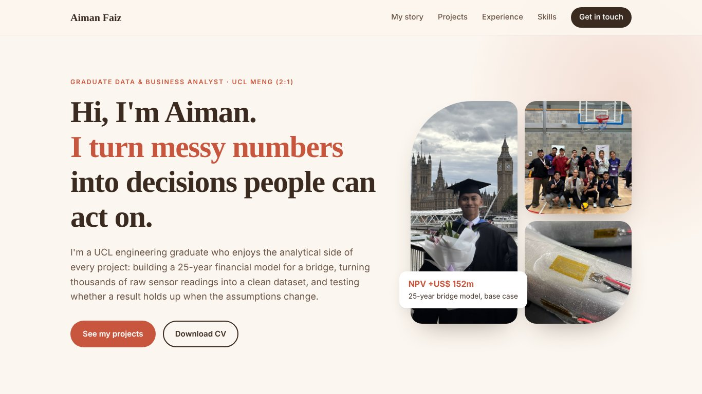

<div align="center">

# Muhamad Aiman Faiz · Data Analyst

**I turn messy numbers into decisions people can act on.**

[](https://muhamadaimanfaiz.github.io/Data-Analyst/)
[](assets/cv/Aiman_Faiz_CV_Data_Analyst.pdf)
[](https://www.linkedin.com/in/muhamadaimanfaiz)

<a href="https://muhamadaimanfaiz.github.io/Data-Analyst/"></a>

</div>

## About me

UCL MEng Mechanical Engineering graduate (2:1, 2026) and MARA Young Talent Programme scholar. Founder of KUGEM Volleyball Club. I'm looking for graduate data analyst and business analyst roles in London.

## Featured projects

| Project | Context | Highlights |
|---|---|---|
| **Singapore–Batam Bridge Financial Model** | UCL finance group project | 25-year cash-flow model, NPV +US$ 152m base case, funding strategy |
| **From Raw Sensor Counts to a Validated Dataset** | MEng capstone, with Cannondale | 16 sensor channels cleaned, repeatability and noise checks, model validation |
| **London Bike-Hire Demand Analysis** | Personal project (in progress) | SQL with CTEs and joins on TfL open data, Tableau dashboard planned |

## Skills

`Excel` `Financial modelling` `NPV & scenario analysis` `Python` `MATLAB` `SQL (learning)` `Tableau (learning)`

## Other portfolios

- [Mechanical Engineering](https://muhamadaimanfaiz.github.io/Mechanical-Engineering/)
- [Management & Business Operations](https://muhamadaimanfaiz.github.io/Management-Business-Operations/)

## About this site

A hand-built, responsive single-page site (HTML, CSS and vanilla JavaScript, no frameworks), hosted on GitHub Pages.

```
├── index.html      page content
├── style.css       layout, colours and fonts
├── script.js       menu, experience tabs, image gallery and lightbox
└── assets
    ├── img         project and personal photos
    └── cv          CV (PDF)
```

## Contact

📧 [aimannfaizz@gmail.com](mailto:aimannfaizz@gmail.com) · 💼 [linkedin.com/in/muhamadaimanfaiz](https://www.linkedin.com/in/muhamadaimanfaiz) · 📍 London, UK
